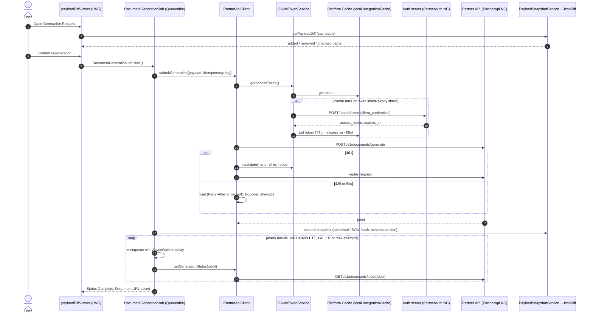

# Apex OAuth Integration Kit

A reusable Salesforce pattern for calling an OAuth 2.0 partner API from Apex, generating documents asynchronously, and showing users exactly what changed before they regenerate.


## Why this exists

Most orgs end up with several integrations that each re-implement token handling, retries and error parsing, usually with a client secret pasted into a custom setting. This kit is the version I would want to inherit: credentials stay in Named and External Credentials, tokens are cached and refreshed safely, failures come back as typed exceptions, and long-running work runs in a bounded async loop. On top of that sits a JSON diff, so before a user regenerates a document they can see which fields changed since the last one went out.

## How it works



## Design decisions

**Token caching with an expiry skew.** `OAuthTokenService` looks for a token in three places: a static copy for the current transaction, the Org Platform Cache partition `local.IntegrationCache`, and finally the token endpoint. A token is treated as expired 60 seconds before the provider says it is, so a request never leaves Salesforce with a token that dies in flight. The cache TTL is set to `expires_in - 60`, and tokens that would live under the Platform Cache minimum of 5 minutes are kept for the transaction only.

**Cache failures cost a callout, never an error.** `PlatformCacheTokenCache` treats a missing partition, zero capacity, eviction or a corrupt entry as a miss. The integration keeps working in an org where nobody allocated cache space; it just asks for tokens more often.

**401 means refresh once, then stop.** A 401 from the partner usually means the cached token was revoked or rotated early. The client invalidates the token everywhere, fetches a new one and replays the request a single time. A second 401 is a real authorization problem and is thrown as a non-retryable `PartnerApiException`.

**Bounded retries that respect Retry-After.** `RetryPolicy` retries 429, transient 5xx (not 501) and transport timeouts with exponential backoff and optional jitter. A `Retry-After` header, in seconds or as an HTTP date, always wins over the computed backoff. Apex has no sleep, so the client only waits inline when the delay fits a small budget and there is CPU headroom. Longer waits are returned to the caller as `isRetryable()` plus `getRetryAfterSeconds()`, and the Queueable turns that into a delayed re-enqueue.

**Polling is a chained Queueable.** Rendering can take minutes and a transaction cannot wait that long. Each `DocumentGenerationJob` execution does one step (submit or poll), saves the result and re-enqueues itself with `AsyncOptions.MinimumQueueableDelayInMinutes`. `Attempts__c` caps the chain so a partner that never finishes cannot loop forever, and a `Finalizer` marks the request Failed if a step dies with an uncatchable error. All callouts in a step run before any DML.

**Schema-versioned snapshots.** Every submit stores the canonical payload (keys sorted, compact), its SHA-256 hash and the payload schema version on a `Payload_Snapshot__c` row. Equal hashes skip the diff entirely. When the schema version differs, the comparison stops at `SCHEMA_MISMATCH` instead of producing a long and misleading diff between two different payload shapes.

**A diff people can read.** `JsonDiff` walks both documents recursively and reports `$.client.address.city`-style paths. Added or removed subtrees are reported once at their root. Numbers compare by value (`450` equals `450.00`), strings compare case-sensitively (the Apex `==` operator does not), type changes are flagged, and arrays of objects can be matched by an identity key such as `id`, so inserting one line item does not mark every later item as changed.

**No secrets in code.** The client id and secret live as parameters on the `PartnerAuth` External Credential principal and reach the token request only through `{!$Credential.PartnerAuth.*}` merge fields. Apex never reads them. Logs mask tokens to their last four characters, and stored error messages carry only the status code and correlation id.

## Using the kit in your org

Any class can reuse the client for its own endpoints. Auth, retries, correlation ids and error mapping come with it.

```apex
public with sharing class InvoiceSyncService {
    private final PartnerApiClient client = new PartnerApiClient().withTimeout(15000);

    public Map<String, Object> fetchInvoice(String invoiceId) {
        try {
            PartnerApiClient.ApiResponse response = client.send(
                'GET', '/v1/invoices/' + EncodingUtil.urlEncode(invoiceId, 'UTF-8'), null, null
            );
            return (Map<String, Object>) JSON.deserializeUntyped(response.body);
        } catch (PartnerApiException e) {
            if (e.isRetryable()) {
                // Hand off to a Queueable and try again in e.getRetryAfterSeconds() seconds.
            }
            throw e; // e.toSafeMessage() includes the HTTP status and correlation id
        }
    }
}
```

Comparing two payloads on their own:

```apex
List<JsonDiff.Change> changes = JsonDiff.compare(previousJson, currentJson,
    new JsonDiff.Options().matchArraysBy('id').ignore('$.generatedAt'));
for (JsonDiff.Change change : changes) {
    System.debug(change.kind + ' ' + change.path); // CHANGED $.items[id=A1].qty
}
```

## Project structure

```
apex-oauth-integration-kit
├── config/project-scratch-def.json          Developer scratch org with PlatformCache
├── sfdx-project.json                        sourceApiVersion 62.0
└── force-app/main/default
    ├── cachePartitions/IntegrationCache     Org cache partition for tokens
    ├── externalCredentials/PartnerAuth      Custom protocol, named principal (no secrets in source)
    ├── namedCredentials/PartnerAuth         Token endpoint, merge fields allowed in body
    ├── namedCredentials/PartnerApi          Partner API base URL
    ├── objects/Generation_Request__c        Status, payload, schema version, hash, job id, attempts, error
    ├── objects/Payload_Snapshot__c          Immutable submitted payloads (master-detail)
    ├── permissionsets/Integration_Kit_User  Object, field, class, tab and principal access
    ├── tabs/Generation_Request__c
    ├── lwc/payloadDiffViewer                Diff table with color chips and confirm-to-regenerate
    └── classes
        ├── OAuthTokenService                Client credentials flow, cache layers, skew, invalidate
        ├── TokenCache / PlatformCacheTokenCache
        ├── PartnerApiClient                 HTTP client: auth, 401 refresh, retries, typed errors
        ├── PartnerApiModels                 Request and response DTOs
        ├── PartnerApiException              Status code, correlation id, retryable flag
        ├── RetryPolicy                      Backoff, jitter, Retry-After parsing
        ├── DocumentGenerationJob            Queueable submit and polling loop with Finalizer
        ├── PayloadSnapshotService           Canonical JSON, hashing, snapshots, comparison
        ├── JsonDiff                         Recursive diff for objects and arrays
        ├── PayloadDiffController            @AuraEnabled API for the LWC
        ├── IntegrationLog                   Correlation ids and secret masking
        └── *Test, TestDataFactory, PartnerApiMock, TestDoubles
```

## Deploy to a scratch org

```bash
# One-time: authorize a Dev Hub
sf org login web --set-default-dev-hub --alias devhub

# Create a scratch org and deploy
sf org create scratch --definition-file config/project-scratch-def.json --alias oauth-kit --set-default --duration-days 7
sf project deploy start --source-dir force-app
sf org assign permset --name Integration_Kit_User

# Run the tests with coverage
sf apex run test --test-level RunLocalTests --code-coverage --result-format human --wait 20
```

Then, in Setup:

1. **Named Credentials > External Credentials > Partner Auth**: edit the `PartnerAuthPrincipal` principal and add two authentication parameters, `ClientId` and `ClientSecret`. Values with characters such as `&` or `+` must be URL-encoded because they are sent in a form body.
2. **Named Credentials**: point `PartnerAuth` at your provider's token host and `PartnerApi` at its API host. The kit expects `POST /oauth/token`, `POST /v1/documents/generate` and `GET /v1/documents/jobs/{jobId}`; change the paths in `OAuthTokenService` and `PartnerApiClient` if yours differ.
3. **Platform Cache**: if the scratch org has no free capacity, the kit still works and simply requests tokens more often.
4. Add **Payload Diff Viewer** to the Generation Request record page in Lightning App Builder.

## Tests

112 test methods across 8 test classes, aimed at more than 90% coverage of every production class. A multi-response `HttpCalloutMock` routes token and API calls to separate queues and records every request, so tests assert on headers, bodies and call counts.

| Area | Scenarios |
| --- | --- |
| Tokens | Cache miss, cache hit, token inside the skew window, corrupt entry, missing partition fallback, invalidate, 401 / 503 / timeout / malformed token responses |
| Client | Headers and idempotency key, 401 then success, 401 twice, 429 with short and long Retry-After, 500 until exhausted, 503 then success, timeouts, 4xx and 501 fail fast, bad bodies |
| Polling | Submit through a real Queueable, chaining with a recording scheduler, polling to COMPLETE, stopping at max attempts, partner FAILED, deferred retries, crash finalizer |
| JsonDiff | Identical, nested, subtree add and remove, type changes, numeric scale, case sensitivity, index and identity-key arrays, ignored paths, quoted keys, invalid JSON |
| Snapshots | Canonical ordering, hashing, sequence numbers, schema-version mismatch, invalid payloads |
| Controller | Every comparison status, counts and rows, row cap, regeneration start and block |

Tests that touch records run as a Standard User with only the `Integration_Kit_User` permission set, so CRUD, FLS and sharing (`WITH USER_MODE`, `as user`) are exercised for real.

## Static analysis

`sf code-analyzer run --rule-selector pmd:Recommended` reports no Critical or High findings. The one suppression is `ApexSuggestUsingNamedCred` on the method that adds the cached bearer token, which is intentional: the endpoint and secret already come from Named and External Credentials.

## License

MIT, see [LICENSE](LICENSE).

---

Built by Sonu Goswami · Portfolio: https://sonugoswami.netlify.app · LinkedIn: https://www.linkedin.com/in/sonugoswami1/
